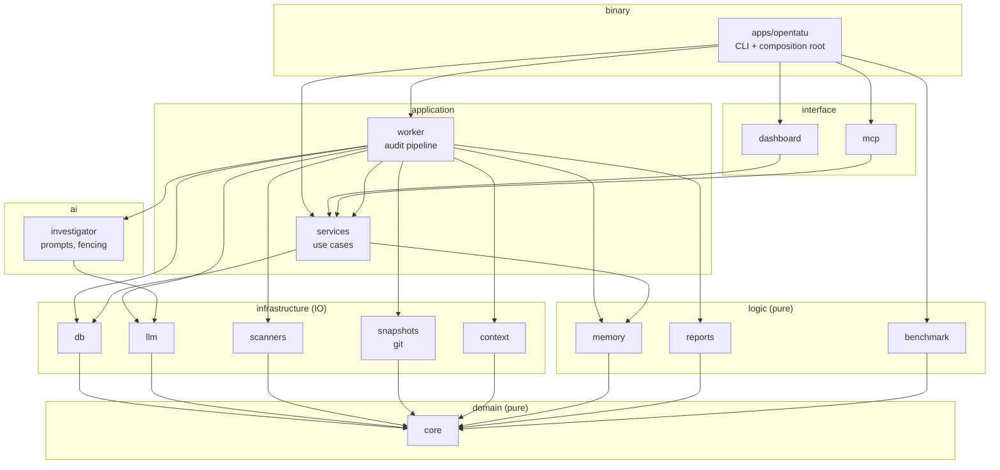
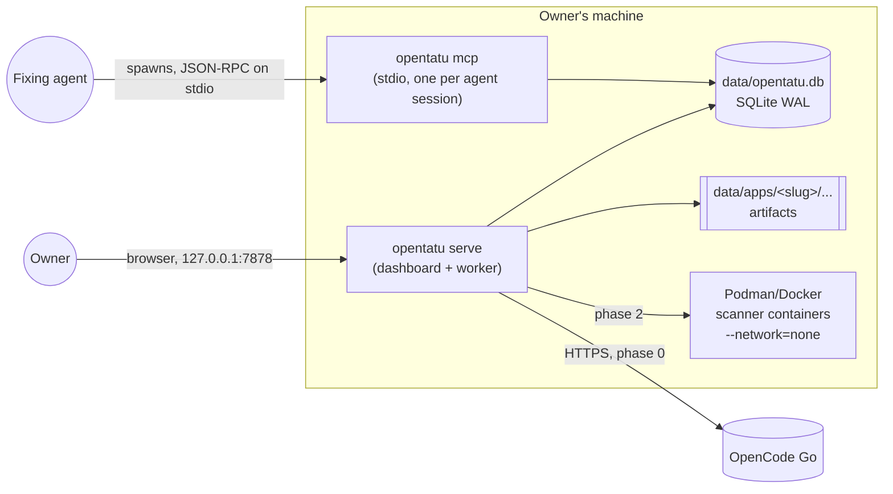
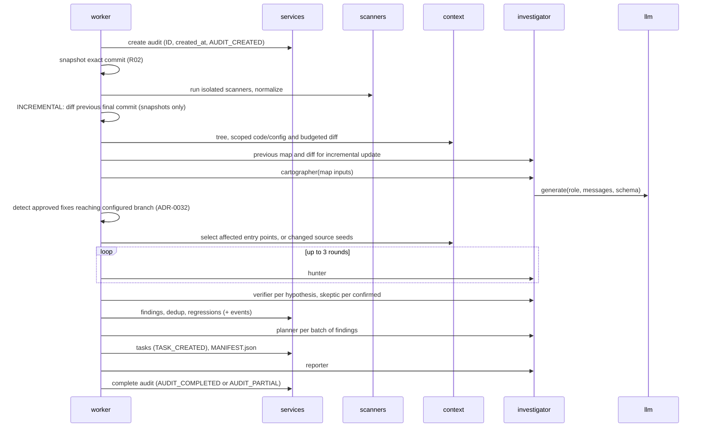

# Architecture

OpenTatu is **one local Rust binary** over **one SQLite file**. It is split into small crates
with one responsibility each, arranged in layers whose dependencies are checked by tests.
The goals, in order: correctness of the business rules, privacy, low footprint, and ease of
safe change by AI agents.

## Principles

1. **Functional core, imperative shell.** Domain rules are pure functions and types
   (`core`, `memory`, `reports`); IO lives at the edges (`db`, `llm`, `scanners`,
   `context`). Pure code is trivial to test and to reason about.
2. **Ports and adapters.** Anything external sits behind a trait in the crate that needs it:
   `Clock` (core), `LlmClient` (llm), `ScannerSuite` (scanners). Tests use the in-repo
   fakes (`FixedClock`, `FakeClient`, `FakeSuite`).
3. **One implementation per use case.** Dashboard, MCP, CLI and worker all call
   `opentatu-services`. Interfaces never reach the database.
4. **Single source of truth for every fact.** Each table below names the one place a fact
   lives; everything else references it (docs/COMPONENTS.md lists them all).
5. **Guardrails over guidelines.** Rules that matter are enforced by the compiler, clippy,
   tests or `cargo xtask` — not only written down.
6. **Local-first and minimal.** One process by default, no runtime services to install
   besides a container engine for scanners, no JavaScript, no CDN.

## Layers



Every crate may also depend on `core`. The authoritative list of allowed edges is
[`architecture.toml`](../architecture.toml); `cargo xtask arch` (and `cargo test
--workspace`) fails on any other edge, on an edge toward a higher layer, on a dependency not
declared in the root `[workspace.dependencies]`, and on a crate missing from the file.

| Crate | Layer | Responsibility | Must NOT |
|---|---|---|---|
| `opentatu-core` | domain | IDs, `Timestamp`/`Clock`, enums with canonical text, finding state machine, severity, events, fingerprint, secret masking | do IO, know about SQL, HTTP or files |
| `opentatu-memory` | logic | `MEMORY.md`, `history.jsonl` lines, audit comparison, dedup by fingerprint | do IO |
| `opentatu-reports` | logic | `audit.json`, `report.md` header, SARIF, `MANIFEST.json` | do IO |
| `opentatu-benchmark` | logic | benchmark app definitions, known flaws from the app's own markers, stripping them, scoring, scoreboard (ADR-0031) | do IO or decide what a finding is |
| `opentatu-db` | infrastructure | SQLite connection, migrations, one repository module per table | contain business decisions |
| `opentatu-llm` | infrastructure | `Llm::generate(context, role, messages, schema)`, OpenCode Go client, model allowlist and training guard, retries, usage recording port | know prompt texts |
| `opentatu-scanners` | infrastructure | isolated containers, scanner adapters, normalized results | run anything outside the isolation flags |
| `opentatu-snapshots` | infrastructure | git mirror per app, revision → commit, checkout of the exact commit (R02) | run git without the hardening options |
| `opentatu-context` | infrastructure | code excerpts per entry point from the snapshot | send whole repositories |
| `opentatu-investigator` | ai | prompt catalog, strict rendering, fencing, (later) output schemas and retries | call scanners or the database |
| `opentatu-services` | application | every use case; transactions with their events | render HTML or speak MCP |
| `opentatu-worker` | application | the §C.7 pipeline, queue, checkpoints, budget enforcement | expose interfaces |
| `opentatu-dashboard` | interface | server-rendered UI, security middleware | touch the database |
| `opentatu-mcp` | interface | MCP tools over stdio | contain business logic |
| `opentatu` (apps) | binary | CLI parsing, config/env loading, wiring | contain business logic |
| `xtask` | tooling | repository checks | ship in the product |

## Runtime



- `opentatu serve` runs dashboard and worker in one process; `dashboard` and
  `worker` can also run alone. SQLite in WAL mode lets the separate `mcp` processes read and
  write safely (`BEGIN IMMEDIATE` + busy timeout).
- The dashboard binds to loopback only; a non-loopback address is refused until owner
  authentication exists (Q-005).
- Logs go to stderr (stdout belongs to command output and the MCP protocol).

## Data and persistence

- **Events are the source of truth** (§B.1). Every use case that changes state appends its
  event(s) **in the same transaction** as the state change (ADR-0006). The `events` table
  rejects UPDATE and DELETE via triggers (R04).
- **Migrations** are embedded SQL files in `crates/db/migrations/`, applied automatically
  when the database opens. Never edit an applied migration; add a new file.
- **Artifacts** (reports, raw scanner output, evidence) are files under the data directory
  (§B.4), referenced from events.
- **Formats** (JSON keys, enum texts, IDs, file names) are English and defined once:
  enum texts in `opentatu_core` via `text_enum!`, IDs in `opentatu_core::ids`, AI output
  keys in the prompts (and, from phase 3, in the output types of the investigator).

## Audit flow (phases 1–5)



## Fix trail (phase 5)

```mermaid
sequenceDiagram
  participant A as fixing agent
  participant M as opentatu mcp
  participant S as services
  participant W as worker
  A->>M: opentatu_list_tasks / opentatu_get_task
  A->>M: opentatu_claim_task (TASK_CLAIMED)
  A->>A: fix on a branch + regression test, push
  A->>M: opentatu_submit_fix(branch, commit)
  M->>S: FIX_SUBMITTED + REVERIFICATION audit queued (first in line)
  W->>W: snapshot the fix commit
  W->>W: verifier on the original hypothesis with <fix>; closed findings' code searched (R09); tests changed (R19)
  W->>S: record_reverification
  alt approved
    S->>S: REVERIFICATION_PASSED, FIX_APPROVED, task DONE
    W->>W: next configured-branch audit detects approved fix
    W->>S: FINDING_CLOSED with branch commit and detection method
  else rejected
    S->>S: REVERIFICATION_FAILED, task reopened with reasons (TASK_CREATED)
  end
  A->>M: opentatu_verification_status
```

## Configuration

| What | Where |
|---|---|
| Secrets and local overrides | environment / `.env` (read only in `apps/opentatu/src/config.rs`) |
| Provider, models per role, allowlist, budgets | [`config/models.toml`](../config/models.toml) (path: `--models-config` / `OPENTATU_MODELS_CONFIG`) |
| Scanner images, versions, ruleset, ecosystems | [`config/scanners.toml`](../config/scanners.toml) (path: `--scanners-config` / `OPENTATU_SCANNERS_CONFIG`) |
| OWASP ASVS catalog | [`config/asvs/`](../config/asvs/README.md), embedded in the binary; applicable level `opentatu_core::APPLICABLE_LEVEL` (Q-013) |
| Owner's name in prompts | `OPENTATU_OWNER` (`.env`) |
| Dependency versions | root `Cargo.toml` `[workspace.dependencies]` |
| Allowed crate dependencies | [`architecture.toml`](../architecture.toml) |
| Lints and banned calls | root `Cargo.toml` `[workspace.lints]` + [`clippy.toml`](../clippy.toml) |

## Extension points

| To add... | Implement / edit | Recipe |
|---|---|---|
| a use case | `impl Services` block in `crates/services/src/<aggregate>.rs` | [add-use-case](recipes/add-use-case.md) |
| an event kind | `EventKind` in `crates/core/src/event.rs` | [add-event-kind](recipes/add-event-kind.md) |
| a table or column | new file in `crates/db/migrations/` + repository module | [add-migration](recipes/add-migration.md) |
| a dashboard page | `crates/dashboard/src/pages/` + template + route | [add-dashboard-page](recipes/add-dashboard-page.md) |
| a UI component | macro in `templates/components/ui.html` (+ `view.rs`, CSS) | [add-ui-component](recipes/add-ui-component.md) |
| a scanner | adapter in `crates/scanners/src/adapters/` + `ScannerKind` variant | [add-scanner](recipes/add-scanner.md) |
| an LLM provider | `LlmClient` impl in `crates/llm/src/` (model: `opencode_go.rs`) | [add-dependency](recipes/add-dependency.md) + an ADR |
| a prompt change | `prompts/<name>.md` + version bump | [change-prompt](recipes/change-prompt.md) |
| an MCP tool | `crates/mcp/src/` over a use case | [add-mcp-tool](recipes/add-mcp-tool.md) |
| a CLI command | `apps/opentatu/src/cli.rs` + `commands/` | [add-cli-command](recipes/add-cli-command.md) |
| a crate | `architecture.toml` + workspace | [add-crate](recipes/add-crate.md) |

## Footprint and performance

- Release profile: thin LTO, one codegen unit, stripped symbols. Dev profile keeps only line
  tables for faster builds.
- Dependencies are declared once with `default-features = false`; adding one requires
  justification ([add-dependency](recipes/add-dependency.md)).
- No JavaScript, one embedded stylesheet, templates compiled into the binary, prompts and
  migrations embedded: the binary is self-contained.
- SQLite: WAL, `synchronous=NORMAL`, small pool (4), indexes for the access paths used.
- Only the context each role needs is sent to the model (§C.7 step 6), which is also the
  main cost lever.

Security of OpenTatu itself: [SECURITY.md](SECURITY.md).

## Phase 7 polling and scope

`Worker::watch_once` refreshes authorized mirrors and resolves each configured branch;
`Services::audit_new_commit` transactionally checks prior final baseline, active work and
last audited branch head. Only a new eligible head queues INCREMENTAL with system/watcher
provenance. `serve` and long-running `worker` poll independently from the single audit
queue, at `--watch-minutes` / `OPENTATU_WATCH_MINUTES` (10 by default, 0 off). `worker
--once` only drains; `watch --once` only polls/queues. No inbound webhook or automatic FULL.

The incremental base is `previous_audit_id` (COMPLETED/PARTIAL, excluding REVERIFICATION).
Scanners still inspect the whole snapshot, but only changed-path results reach the hunter.
Context reuses depth-2 dependency selection on old/new snapshots to identify affected
handlers, includes new entries, and falls back to changed source files. Unchanged map
records are retained and unexamined coverage remains NOT_TESTED. Scope is explicit in
`audit.json` and the system-owned report section. INCREMENTAL has its configured budget.
See ADR-0033; PAUSED resumption remains deferred to Q-032.
