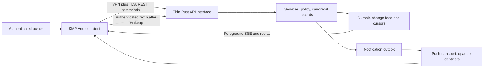

# OpenTatu Android and mobile conversation plan

Status: proposed for S7. The owner selected read-only monitoring and an existing Android
alert transport for the first MVP; this custom application is a later release. It is a
separate OpenTatu client, with no changes to Abastevo's Android application.

## Architecture and delivery boundary

Proposed source root: `mobile/`, with its own `AGENTS.md`, Gradle wrapper/version catalog,
`shared/domain`, `shared/data`, `shared/network`, `shared/storage`, `shared/ui`,
`androidApp`, and a later `iosApp`. Start with the fewest modules that enforce these
responsibilities; do not create an empty module tree. Android is the first executable
target. Shared logic covers validated DTOs, reducers, repositories, synchronization and
cache; platform ports cover secure credentials, push, background work and biometric UI.
The Rust backend remains one binary without JavaScript or Node.

Compose Multiplatform is the recommended candidate for shared UI: the official
[platform stability record](https://kotlinlang.org/docs/multiplatform/supported-platforms.html)
lists Android and iOS as stable. Final library, Kotlin, Gradle, Android SDK and minimum
device versions are selected and pinned together during S7, with a compatibility ADR and
license check. No version is guessed here. iOS builds/signing require a Mac and Apple's
toolchain, as described in the [KMP FAQ](https://kotlinlang.org/docs/multiplatform/faq.html).
Architectural preparation is distinct from delivering an iOS application.

## Navigation and textual wireframes

These wireframes describe content hierarchy in English; future runtime text uses pt-BR
under ADR-0001. Primary navigation: Conversations, Applications, Approvals, Settings.
Teams and provider configuration are reached through Settings and relevant conversations.

**Conversations list**

```text
OpenTatu                         Connection: current / last synchronized
Priority incident                [unread count] [monitoring freshness]
Team room                        latest relevant update · server time
Abastevo security                latest update · priority
Incident room                    classification · lifecycle · unread
Investigator                     most recent assigned task result
```

Rows have avatar/name/last message/time/status/unread count/priority. Read positions are
server cursors per conversation/device; priority never replaces chronology. Include search
and scope filters only after base synchronization works.

**Team room and direct agent conversation**

```text
Team / named agent               scope: application selector
Monitoring status card           last observation · active limitations
Attributed messages              concise observations with evidence links
Task card                        queued / running / partial / completed
Owner question input             submit / cancel pending request
```

The owner can ask about current status, recent hours, authentication changes, a threat,
post-deploy behavior, known findings, recommended actions and whether work was verified.
Answers cite data freshness, coverage and evidence. Agents respond only when assigned a
relevant task. Free text requesting a block creates a proposal, never an execution grant.

**Incident room**

```text
Incident title                   priority · lifecycle · conclusion confidence
What happened                    observed facts and affected application
Evidence card                    source · time · available / expired
Timeline                         signals, hypotheses, objections, decisions
Action proposal                  impact · duration · rollback · approval state
Result                           execution outcome and separate verification
```

Cards render canonical typed records; the app does not parse an LLM sentence to create an
incident, permission or approval. Show “insufficient evidence” and stale data prominently.

**Applications**

```text
Application                      active / degraded / stale / unknown
Collector status                 last heartbeat · delivery gap
Incidents and alerts             priority and open count
Adapters and team                version · permissions · task status
Audit context                    last audit · deployed commit match · open findings
History and allowed settings
```

**Approval center and exact review**

```text
Pending proposals                expires at · affected application
Exact action and target          requesting identity · immutable proposal version
Evidence and uncertainty         false-positive risk · expected impact
Duration and reversibility       protected access · rollback · policy checks
Approve / Reject / More information
```

At S7 this can display proposals and disabled future execution actions; S9 introduces
authenticated simulation approval. S10 enables only individually released playbooks.
Approval controls require fresh online server state and reauthentication; a push tap or
offline cached card cannot approve. Expired/revoked/changed proposals show why they cannot
execute. Notifications never contain approval bearer tokens.

**Teams and AI settings**

Show roles, enabled/busy/degraded state, tasks, model bindings, authorized tools, scope,
usage and caps. Initially view-only except selecting an already authorized binding under
owner authentication. Credentials remain server-side; granting a model a role never grants
production privileges. Complex team editing and arbitrary prompts are deferred.

## Authentication and connection

Use the owner's approved dedicated Sentinel VPS through a VPN. A private address is not
authentication. Complete owner authentication, TLS, bootstrap/recovery, device enrollment,
revocation and session design before exposing the API. Preserve the existing required
password + TOTP + short sessions from Q-005; any alternative needs an explicit ADR.

Proposed enrollment uses a local authenticated owner session, a short-lived single-use
pairing challenge and device confirmation. The challenge contains no infrastructure or
provider credentials. Server stores revocable device credentials hashed where possible;
Android uses platform-backed secure storage rather than shared plaintext preferences.
Biometric unlock protects local access but does not independently establish server
authorization. Reinstall, device loss and VPN loss have documented recovery paths.

## REST commands and resumable synchronization

Use an authenticated API under `/api/sentinel/v1`. Queries cover conversations/messages,
incidents/evidence metadata, apps/adapters, tasks, team state, provider bindings and
approvals. Mutations are typed commands with `command_id`/idempotency key, expected
resource version, authenticated actor and a bounded payload. Server assigns all authority,
timestamps and outcomes. Distinguish message submission, investigation request, task
cancellation, proposal rejection, information request and approval.

Recommend REST plus SSE for foreground synchronization initially; WebSocket is deferred
until bidirectional traffic proves necessary. Shared DTO/cursor semantics must remain
transport-independent. This client stream does not add JavaScript to the dashboard.



The durable feed has monotonic server cursors, entity version and event type. Replay is
paginated; reconnect resumes after last committed cursor. Atomically apply a page and its
cursor to local cache. Deduplicate by stable event/message/command ID, not text or time.
If a cursor predates retained feed data, return `RESYNC_REQUIRED` and a consistent snapshot
with a fresh cursor. Use bounded heartbeat/retry and verify proxy idle timeouts. Event
visibility is checked during replay as well as live delivery. Revocation terminates streams.

Offline: read last authorized cached summaries with last-sync and stale indicators; queue
ordinary questions/drafts only, using idempotency. Do not queue approvals, replay privileged
commands or pretend monitoring is current. Sensitive evidence caching is minimized and
expires under policy; logout/device revocation removes local secrets and cache. Server
revocation cannot erase an offline stolen device immediately; document that residual risk.

## Android alerts now and native push later

S3 evaluates a standard existing Android transport such as authenticated ntfy, with a
fallback channel and explicit owner choice before any service registration. Its
[official FAQ](https://docs.ntfy.sh/faq/) documents Android/iOS clients and self-hosting;
delivery behavior depends on hosting and client configuration. No extra notification
server is a mandatory OpenTatu dependency. A VPN-only provider and a managed relay have
different availability/metadata tradeoffs; validate on the actual device before selecting.

For the custom client, wrap Android FCM behind a platform port; use APNs later for iOS,
directly or through an approved cross-platform service. FCM needs the appropriate device
services and owner account configuration; test the actual phone, permissions, power-saving
and background restrictions. Choose an alternate platform transport if those assumptions
fail. A push wakes/prompts synchronization and carries an opaque notification/entity ID
with generic content, never logs, findings, credentials or direct execution authority.

Persist notification intent and delivery attempts. Distinguish queued, provider accepted,
device acknowledged and owner read, with `unknown` where evidence is missing. FCM reporting
is aggregated and incomplete, so it cannot prove an individual notification reached the
owner; see [delivery reporting](https://firebase.google.com/docs/cloud-messaging/understand-delivery).
Use app receipts/last-sync freshness and a tested fallback for critical alerts. An external
dead-man monitor, in a separate failure domain, detects Sentinel VPS silence; the VPS
cannot reliably report its own total loss. Notification retries never require AI.

## Visual system, accessibility and acceptance

Inventory existing brand assets during S7; use existing dashboard tokens as the reference
and document missing assets. Navy/teal and armadillo direction is a proposal, not evidence
of existing files. Avoid a literal messenger clone. Provide readable contrast, scalable
type, TalkBack labels, logical focus, adequate touch targets and text alongside priority
colors. Keep localization resources ready for additional languages; initial UI is pt-BR.

Tests: shared reducer/network/cache tests with synthetic pages; Android UI tests for all
screens, auth and permission denial; scenario M disconnect/replay without duplicate
messages/actions; scenario H online exact simulation approval with expiry/replay checks;
push-to-authenticated-deep-link behavior; logout/revocation; no secret in app logs/backups;
accessibility and small/large-font layouts; battery/network cost on the actual phone.
Pin SDK versions and document reproducible Gradle/Android test commands when the project
exists. Rust backend checks remain `cargo xtask check`; mobile checks are added to CI
without replacing or weakening them.
