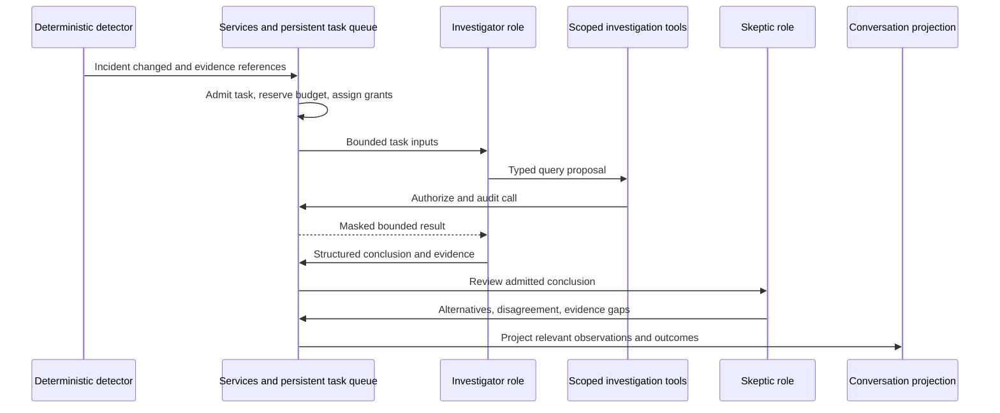

# Security teams and conversation runtime plan

Status: proposed for S5–S6; advanced role customization follows the initial Android
client. Requirement scope: SREQ-035–054 and SREQ-071–074 in the
[master plan](SENTINEL_MASTER_PLAN.md). Runtime implementation must reuse existing role
execution and accounting rather than introduce another path to a model.

## Identity and responsibilities

An `AgentDefinition` is a configured identity in OpenTatu, independent of its current
provider/model. It holds `agent_id`, display name, role binding, team membership, enabled
state, allowed applications, tool grants, authorized memory views, communication policy,
budget policy and provider selection policy. Version configuration and record changes.
Do not confuse this identity with `AiRole` (a responsibility), a provider session, or the
existing external fixing agent actor. Extend the canonical domain vocabulary before adding
new type names; preserve existing six Audit role names and serialized forms.

- **Sentinel coordinator:** deterministic task admission, assignment, cancellation and
  escalation. An optional model summary cannot change policy or grant capabilities.
- **Observer:** deterministic rules and local statistics first; a model may later explain
  admitted signals, without becoming the primary detector.
- **Investigator:** the first runtime AI capability; queries scoped evidence and returns
  structured hypotheses, observations, gaps and recommended next queries.
- **Skeptic:** reuses the existing skeptical-review responsibility with a runtime-specific
  schema. Challenges claims and records alternatives; cannot erase prior conclusions.
- **Guardian:** later uses the existing planning responsibility where practical to propose
  typed playbooks. A separate display identity does not require duplicated planner logic.
- **Verifier:** reuses verification primitives, with incident-action postconditions rather
  than conflating them with Audit reverification.
- **Messenger:** deterministic templates first, later the reporter's explanation capability.
  It renders facts and uncertainty for the owner; it has no response permissions.

S5 ships coordinator + one Investigator. S6 adds a Skeptic and a bounded shared team room.
Observer, Guardian, Verifier and Messenger become independent active identities only when
a task needs their responsibility. “Online” is an enabled state, never a reason to call a
model. A quiet system consumes zero AI calls.

## Separate records from conversation display

`Message` is an attributed human-readable statement. `Command` is an authenticated request
to a use case. `Event` records a fact. `InvestigationTask` is scheduled work, distinct from
the existing Audit fix `TaskId`. `Incident` groups signals. `IncidentEvidence` references
verified source material. `Approval` authorizes one exact proposal. `ToolResult` is a
bounded execution outcome. `Notification` is a delivery intent. Each is typed in core,
persisted through db/services, and referenced from conversation cards. Do not create a
single JSON blob table that treats all nine as interchangeable messages.

Synthetic message proposal:

```json
{
  "schema_version": "1.0",
  "message_id": "server-assigned-message-id",
  "conversation_id": "incident-conversation-id",
  "application_id": "demo",
  "incident_id": "incident-id",
  "author_id": "agent-investigator",
  "recipient_ids": ["agent-skeptic"],
  "reply_to_message_id": "prior-message-id",
  "caused_by_event_id": "EVT-00000001",
  "task_id": "investigation-task-id",
  "kind": "OBSERVATION",
  "text": "Synthetic explanatory observation",
  "evidence_references": ["authorized-evidence-id"],
  "created_at": "2026-11-12T10:00:00Z",
  "visibility": "APPLICATION_TEAM"
}
```

The server assigns author from the authenticated task principal and timestamps from
`Clock`. The example is not permission to supply those values in an incoming chat command.
Mentions and replies affect display or request a task; they never grant authority.
Messages can be corrected only by appending a superseding message/event.

Synthetic task proposal:

```json
{
  "schema_version": "1.0",
  "task_id": "server-assigned-investigation-task-id",
  "application_id": "demo",
  "incident_id": "incident-id",
  "assigned_agent_id": "agent-investigator",
  "parent_task_id": null,
  "objective_code": "CORRELATE_AUTH_FAILURES",
  "input_references": ["incident-evidence-set"],
  "grant_id": "scoped-read-grant",
  "budget_policy_id": "approved-investigation-budget",
  "state": "QUEUED",
  "version": 1,
  "deadline_at": "2026-11-12T10:05:00Z",
  "idempotency_key": "incident-id:correlate:1"
}
```

Operational columns additionally hold lease owner/expiry, attempt count, next eligible
time, cancellation token, result reference and budget reservation. Task transitions:
`QUEUED -> RUNNING | CANCELLED | TIMED_OUT`;
`RUNNING -> COMPLETED | FAILED | PAUSED | CANCELLED | TIMED_OUT`;
`RUNNING -> QUEUED` only after a lease expires and deterministic reconciliation establishes
retry eligibility under the same caps; `PAUSED -> QUEUED | CANCELLED | TIMED_OUT` only
under the authorized resumption/cancellation policy. Other terminal states have no outgoing
transition; a new authorized attempt is a linked task. Crash recovery records the lease
expiry and attempt event before requeue. Completed tool side effects are
reconciled by idempotency key, not blindly repeated. Optimistic version checks reject stale
results. Revoked grants are rechecked at every tool call and before accepting a result.

## Event-driven coordination



The Agent Conversation Bus is initially a persistent set of typed tasks/events and
projections in SQLite, with bounded Tokio wakeups. No Kafka, independent broker or endless
agent chat loop. Task insertion and corresponding history event commit together; wakeups
are hints, so restart scans persisted eligible work. Do not poll a model to discover work.
Application and incident references are mandatory for operational tasks; the general room
creates separately scoped requests for each app instead of sharing all evidence by default.

Investigations may query events, metrics, incident history, health, Audit findings and
deployed version. Queries have fixed filters, pagination, time bounds and evidence handles.
There is no raw SQL, arbitrary HTTP, shell or filesystem tool. In the absence of provider
native tool calls, use a strict validated “query proposal -> deterministic tool -> result”
loop around `run_role`; protocol-native support can later share the same policy boundary.

## Investigation MCP catalog and query contract

This is the canonical proposed operational catalog for S5; it is distinct from the
Factory and phase-5 fixing tools. Every tool calls services and checks authenticated
scope, effective grants, output budget and revocation on each invocation.

- `opentatu_sentinel_query_events`: bounded app/time/type/cursor query over authorized
  retained normalized telemetry; no raw log dump or arbitrary expression language.
- `opentatu_sentinel_query_metrics`: allowlisted metric/window/aggregation with freshness,
  reset/unknown state and bounded series. No arbitrary metric-label scan.
- `opentatu_sentinel_get_incident`: incident summary, classification, lifecycle and
  authorized evidence references by ID and expected revision.
- `opentatu_sentinel_get_evidence`: a bounded authorized evidence excerpt or explicit
  `EXPIRED`/`MISSING`, with digest/provenance. Opaque handles only.
- `opentatu_sentinel_history`: paginated minimized incident/task/tool/decision history.
- `opentatu_sentinel_health`: collector/processing/delivery visibility state and gaps.
- `opentatu_sentinel_audit_context`: finding/map references with audited and deployed
  revision relationship; never closes a finding or returns unrelated source code.
- `opentatu_sentinel_deployed_version`: last verified deployment identity and freshness;
  returns `UNKNOWN` when deployment evidence is absent.
- `opentatu_sentinel_request_analysis`: idempotent task request, subject to deterministic
  admission/reservations and granted objective codes. It cannot grant new tools.
- `opentatu_sentinel_propose_action`: introduced at S9 only, creates a typed local
  proposal; it cannot approve or execute an effect. Before S9, recommendations are
  bounded structured observations with no executable action grant.

Example event-query input:

```json
{
  "application_id": "demo",
  "incident_id": "authorized-incident-id",
  "from_received_at": "2026-11-12T09:55:00Z",
  "to_received_at": "2026-11-12T10:00:00Z",
  "event_types": ["authentication.rejected"],
  "cursor": null,
  "limit": 50
}
```

`application_id` is required; incident is optional if the grant allows broader scoped
reads. Time bounds and `limit` are required. Candidate caps are 24 hours and 100 rows per
page, with a stricter grant able to reduce either; approve actual caps at S0. Cursors are
opaque server-issued handles bound to app/query/snapshot and expiry. Reject unknown input
fields, reversed/oversized windows, arbitrary filters and changed cursor scope. No input
author/role/principal/grant field is accepted. Server authorizes every referenced incident.

Example normalized result:

```json
{
  "tool_call_id": "server-call-id",
  "application_id": "demo",
  "status": "COMPLETED",
  "items": [{"telemetry_reference": "scoped-event-id", "event_type": "authentication.rejected"}],
  "next_cursor": null,
  "truncated": false,
  "as_of": "2026-11-12T10:00:00Z",
  "coverage": {"freshness": "CURRENT", "limitation_codes": []},
  "evidence_references": ["authorized-evidence-id"],
  "error": null
}
```

Output variants are typed per tool and share this bounded provenance/page/error envelope.
`as_of` is server time from `Clock`. Missing or expired source evidence is visible;
`truncated` and `next_cursor` prevent an incomplete page being read as a complete search.
Stable errors include `UNAUTHORIZED`, `OUT_OF_SCOPE`, `INVALID_INPUT`, `STALE_CURSOR`,
`NOT_AVAILABLE`, `LIMIT_EXCEEDED` and `TIMEOUT`. Denials expose no foreign resource
existence. Every call produces its canonical Q-007 event, including denied/failed calls;
no tool result is trusted as a privileged instruction by the next agent.

## Limits and failure behavior

All numeric defaults below are engineering proposals awaiting S0 budget approval:
one active investigation per app, two globally; at most 8 model turns, 20 tool calls,
30 team messages and 5 minutes per incident investigation; delegation depth 2 and at most
4 tasks. The actual token and currency envelope must be explicitly configured from
authorized provider research before any calls. Bound each result/context and reserve the
worst allowed output cost before dispatch. Retries, Skeptic calls and fallbacks share the
same incident envelope and monthly reservation ledger.

Store a delegation DAG and reject self-delegation, ancestor delegation and duplicate open
objectives. Reaching a cap produces a structured partial conclusion and owner escalation,
not another round. Cancellation stops new work immediately and prevents late model
responses from causing effects. Provider failure marks investigation `PAUSED`/degraded;
it cannot stop deterministic detection or notification. Unknown tool outcomes are
reconciled before retry. Persist task deadlines and use injected time for deterministic
expiry tests. Scheduling quotas reserve capacity for collector health and critical alerts.

## Memory and reasoning records

Operational memory is current incident/task state. Historical memory is the immutable
decision/tool/action ledger. Investigative memory is evidence-linked hypotheses and
reviewed conclusions. Application memory is approved profile, Audit context and measured
behavior summaries. Team memory is scoped shared messages and delegations. These are
views over canonical records, not independent stores with conflicting facts.

Retrieve only the task's granted app/incident/time window. Include provenance, version,
collection time and evidence availability. Summaries link to original records and can be
superseded, never promoted to primary evidence. Expired evidence remains visibly expired.
Store observations, sources, alternatives and concise verifiable justifications. Do not
request or persist private model chain-of-thought. Peer messages and tool output remain
untrusted content fenced by existing rendering primitives. Fencing supplements capability
enforcement; it is not a guarantee that a model will ignore an injection.

## Acceptance

Scenario G admits coordinator, Investigator and Skeptic tasks with causal evidence-linked
messages within caps. Scenario K submits hostile logs and peer messages without privilege
gain. Scenario L makes a forged agent request an ungranted action; the deterministic
runtime denies it. Test crash-after-claim, lease expiry, replay, cancellation, budget
exhaustion with concurrent requests, provider outage, cross-app memory reads, stale
conclusions and an idle soak with zero calls. Reuse `FixedClock`, `FakeClient` and
`Services::in_memory`; introduce only missing shared fixtures in their owning crate.
