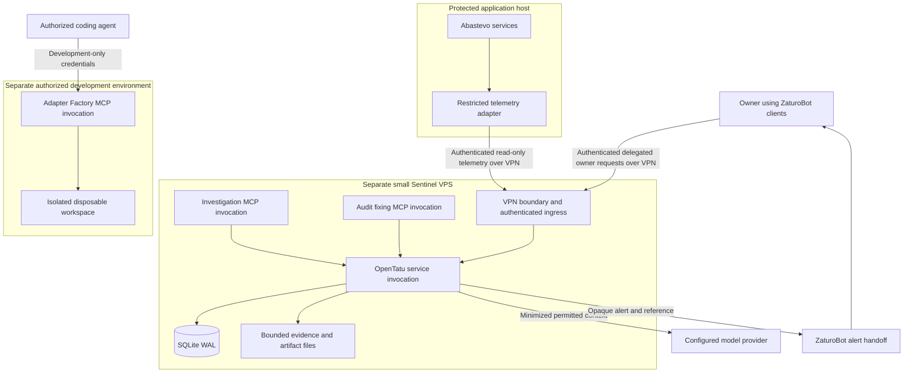
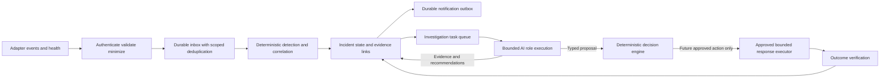
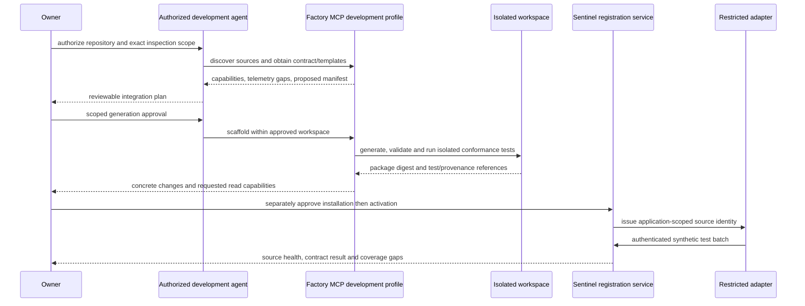

# Sentinel architecture proposal

Status: proposed expansion design, originally based on the 2026-11-12 working tree.
Kickoff update (2026-11-13): original phases 0–10 are delivered; Q-017/Q-038 authorize
the narrow S0.1 pure foundation. Its implementation adds no crate, production dependency
or architecture edge. Proposed layouts below remain gated by the existing workflow.

The owner selected a separate small Sentinel VPS connected to protected applications
through a VPN. On 2026-11-14 the owner selected ZaturoBot as the bot/application surface
for managing OpenTatu as a service (ADR-0038); a separate OpenTatu mobile application is
no longer planned. S3 provides the minimal read-only alert handoff; S7 provides fuller
authenticated service management and projections. The exact integration transport,
delegated owner identity and ACK contract remain Q-040 decisions. Canonical scope:
[ZaturoBot integration](ZATUROBOT_INTEGRATION_PLAN.md).

## Existing foundations and boundaries

The [existing architecture](../ARCHITECTURE.md), [component catalog](../COMPONENTS.md),
[business rules](../spec/A-business-rules.md), [security model](../SECURITY.md) and
[ADRs](../DECISIONS.md) remain authoritative. The historical planning inspection was
phase 3 plus uncommitted phase 4. Current kickoff HEAD is
`9824bccb7ea2a7b552acadd0de06a2921a2ad96e`, with original phases 0–10 delivered and fixing
MCP operational. Factory and Investigation MCP profiles remain unimplemented. CrowdSec's
scoped observations/responses are not a universal authenticated Sentinel ingest protocol.

Keep a modular monolith: one Rust executable, SQLite WAL, Tokio tasks, embedded
prompts/templates/migrations and the existing server-rendered local administrative
dashboard and CLI. Additional invocations of the same executable may provide distinct
MCP profiles. ZaturoBot owns client code, platform storage and distribution in its own
repository; no `mobile/`, Gradle/KMP or iOS project is added to OpenTatu. No Kubernetes,
broker, Redis, Elasticsearch or PostgreSQL is required for Sentinel; the protected
application's PostgreSQL is not Sentinel's datastore.

Domain entities, typed IDs, states and deterministic rules belong in `opentatu-core`; SQL and migrations belong exclusively in `opentatu-db`; use cases belong in `opentatu-services`; interfaces remain thin. Reuse `Clock`, `Timestamp`, `Secret`, `Actor`, events, app identity, validated Audit findings and evidence references. Existing interface crates keep their currently allowed edges. This proposal names logical components rather than adding crate dependencies. Any new infrastructure port, crate, process capability or dependency edge needs an accepted ADR and the repository's dependency recipe before implementation.

## Proposed code map and ownership

This is the recommended placement map; `[extend]` means existing crate, `[new proposal]`
means a future crate/layout requiring Q-023 and an accepted ADR. It creates no directory
or dependency in this planning change. Per-phase paths in the roadmap refine this map.

```text
apps/opentatu/                         [extend] same executable and composition root
  src/config.rs                       source/integration/provider credential references
  src/cli.rs, src/commands/            scoped future Sentinel and MCP profile commands
crates/core/                          [extend] all domain contracts and pure policies
  src/telemetry.rs, adapter.rs         universal input/event/manifest/capability types
  src/detection.rs, incident.rs        rule signals, incident lifecycle/evidence
  src/agent.rs, investigation_task.rs  stable identities, grants and task transitions
  src/conversation.rs, action.rs       messages/commands, proposals/decisions/approvals
crates/db/                            [extend] every SQL query and migration
  src/telemetry.rs, adapters.rs        scoped inbox, dedup, checkpoints and retention
  src/incidents.rs, teams.rs           projections, evidence, messages/tasks/leases
  src/notifications.rs, approvals.rs   durable outbox, decisions/grants/operations
  migrations/<next>_sentinel_*.sql     append-only migration sequence chosen at kickoff
crates/services/                      [extend] shared policy and use-case entry points
  src/telemetry.rs, incidents.rs       authorization, ingest and incident transitions
  src/adapter_factory/                authorized workspace/package state
  src/teams.rs, response_policy.rs     admission, reservations and exact action policy
crates/worker/src/sentinel/            [extend] bounded scheduling, no interface logic
  ingestion.rs, detection.rs           cursor/window processing and source health
  notifications.rs, investigation.rs  outbox delivery, tool loop and recovery
  teams.rs, response.rs                delegation, reconciliation, verification/TTL
crates/mcp/src/                       [extend] thin tools calling services
  factory/, investigation/             separate profiles; retain phase-5 fixing tools
crates/dashboard/src/                 [extend] existing local owner views
  pages/, view/                       reuse service-backed HTML projections
future integration facade             [proposal] placement/transport under Q-023/Q-040
crates/dashboard/templates/           [extend] reuse components/ui.html macros
crates/llm/, investigator/             [extend] existing provider/role path and fakes
crates/memory/, reports/              [extend] pure incident views/provenance as needed
crates/snapshots/                     [reuse] sole hardened git implementation
crates/scanners/                      [reuse] scanner execution/isolation builder
crates/telemetry/                     [new proposal] restricted source readers/parsers
crates/notifications/                 [new proposal] selected transport implementations
crates/responses/                     [new proposal] typed target IO at S10 only
config/sentinel.toml                  [new proposal] bounded source/rule/queue policies
config/adapters/                      [new proposal] curated manifests/templates
prompts/                              [extend] versioned runtime-role contexts
external ZaturoBot repository          [later authorized task] bot/app presentation
docs/recipes/                         [future] adapter/lab/recovery maintenance recipes
```

The candidate infrastructure crates expose narrow traits/fakes using core types, following
the existing `LlmClient`/`ScannerSuite` pattern. Worker depends on those approved ports;
binary wires concrete implementations; services only decides/persists intent and outcome.
Infrastructure must not import the higher services/worker layer. Interfaces keep only
core/services dependencies. Proposed additional checked edges are worker -> selected
infrastructure and binary -> selected infrastructure; each is individually justified and
accepted before editing `architecture.toml`. SQL never leaves db, domain types never
leave core, and new network/file IO is never hidden in a pure crate or an HTTP handler.

Factory sandbox execution is a separate decision: extend a typed isolated-executor port
in scanners only if its responsibility remains coherent, otherwise propose a dedicated
infrastructure owner and updated guardrails. Do not create all candidate crates eagerly;
add only the one needed by the approved slice. Adapter packages remain declarative,
application-specific translation configurations/fixtures initially, not dynamically loaded
native plugins. A future executable bridge needs explicit packaging and sandbox review.

## Deployment and trust zones



Arrows represent proposed logical contracts, not new `architecture.toml` edges or implemented network transports. MCP stdio remains appropriate for local agent sessions. Remote MCP is a separate gated ADR; neither a public MCP endpoint nor public dashboard exposure is implied. Never host the Factory's build/test workspace with production credentials. The Factory can consume released schemas/templates without connecting to the live incident store.

A VPN is an access restriction, not application authentication. Register source adapters
and the ZaturoBot integration principal independently; scope credentials to audience,
application, environment, operation and expiry. Q-040 defines how authenticated owner
context is verified across that external trust boundary; a bot/client identity label is
not proof. ZaturoBot owns its device/session lifecycle, while OpenTatu independently
checks delegated owner authority and integration revocation. Keep provider/executor keys,
security policy, budgets, approvals and execution on the OpenTatu service side. The
bot/app receives only authorized projections and request results.

Treat that output as disclosure across an additional confidentiality boundary. ZaturoBot's
ordinary model/tool path for public-coding diagnostics does not gain access to runtime
incidents. Apply an approved field policy to sanitized service projections and opaque
references; runtime model disclosure/consent and shared budgets keep their own gates.
OpenTatu Clock timestamps remain authoritative for its history and approvals; Q-040
defines any cross-project timestamp-unit/precision conversion rather than reusing
external feed time as an approval clock.

## Deterministic runtime and AI-assisted runtime



The first release stops at read-only collection, detection, incidents and notification. AI investigation enriches an already-recorded incident and is never on the critical path for receiving events, detecting a rule match or alerting the owner. Response execution is delivered later and remains disabled until its separate gate passes.

The Collector authenticates first, enforces byte/batch/cardinality limits, validates the versioned schema and applies data minimization. Persist the accepted envelope and its deduplication identity atomically before acknowledging durable receipt. Acknowledgment means stored, not investigated or resolved. Return structured rejections for invalid events and a retryable overload result for unavailable capacity; malformed content cannot terminate other streams.

Detection consumes durable, ordered processing cursors and records rule version, window, measured values, confidence inputs and coverage gaps. Use fixed windows and simple bounded statistical baselines first; models do not score each log. Rule changes are versioned. Warm-up, missing telemetry, stale baselines and source clock uncertainty remain visible. A quiet feed cannot establish safety.

The Incident Engine correlates within explicit application and rule/fingerprint scopes. Retain separate concepts for suspicious signal, active investigation, probable attack, confirmed compromise, false positive and operational issue. A lifecycle such as open/investigating/contained/resolved is separate from the confidence classification. Resolution of a runtime incident does not close an Audit finding.

The Notification Engine reads a transactional outbox and hands off deterministic safe
alert content to ZaturoBot even if every model is unavailable. Persist attempts, retry
state, durable integration ACK, observable client synchronization and owner acknowledgment
separately; none implies another. Q-040 defines actual transport/ACK semantics. Alert
aggregation reduces storms without suppressing distinct critical incidents. An approved
watchdog must also detect failures outside the shared OpenTatu/ZaturoBot failure domain.

## Time and event identity

`observed_at` is an adapter-reported source timestamp with known parsing, timezone and uncertainty rules. It is untrusted evidence and must not become an authorization or approval clock. `received_at`, incident creation, task deadlines, approvals, notification times and all other system timestamps come from injected `Clock`. Preserve R03 and document this source-versus-system distinction.

Use server-assigned internal IDs and a separate source event identity. Deduplicate on authenticated application + adapter instance + stream epoch + source event ID/sequence, not a globally supplied `event_id` alone. Bind payload integrity to this identity; conflicting reuse is an integrity anomaly. Source restarts, log rotation, replay, clock skew, late events and batch partial acknowledgment need explicit contract cases.

MVP correlation uses server receipt-time windows, as defined in the canonical
[adapter protocol](ADAPTER_PROTOCOL.md). Source-time windows are opt-in only after skew and
allowed-lateness policy approval. Late evidence can append a corrected conclusion, never
overwrite prior recorded decisions. Request IDs and external correlation IDs are untrusted
hints, not authorization credentials.

## Persistence and retention

Candidate domain aggregates are application capability grants, adapter registrations/
versions, normalized telemetry, detection rule versions/runs, incidents, evidence
references, investigation tasks, agent profiles, conversation messages, action proposals/
approvals/executions, integration identities/revocations and notification attempts. Define
these once in core and store them through db repositories and services. ZaturoBot's feed
and UI cache are projections, not duplicate incident or approval authorities. Avoid copying
full Audit artifacts into each incident: reference app, exact audited commit, finding ID,
deployed commit and evidence provenance.

Use short write transactions, bounded batches and indexed cursor reads. Suggested index access paths are application/time, application/event type/time, incident/evidence, task status/next-run, and outbox status/next-attempt. Validate them with `EXPLAIN QUERY PLAN` and workload measurements during implementation. Do not create one immutable domain-history row for every raw access-log line by default.

The owner approved proposing expiry of raw telemetry and sensitive evidence with minimized permanent incident history. Implementing that boundary requires an accepted retention ADR because R04 currently says history is never deleted. Keep existing `events` append-only triggers unchanged. Distinguish temporary telemetry payloads/evidence bytes from permanent decisions, aggregate findings and provenance. The permanent record can retain a digest and an explicit expired-evidence marker; it must not imply evidence remains available. Exact categories, durations, legal holds, backup expiry and minimum evidence required to retain a conclusion remain open until accepted. Store no real application samples in the public repository.

SQLite WAL and `synchronous=NORMAL` already exist; assess whether accepted alert/approval durability requires a stronger mode under power loss. An acknowledgment promise must match the selected durability. Back up SQLite through a consistent backup mechanism plus artifact snapshot metadata; copying an active database file alone is insufficient. Test restoration, schema compatibility, key recovery and outbox replay with synthetic data.

## Scheduling, concurrency and restart

The existing audit worker executes audits sequentially and stores checkpoints. It is not a general durable scheduler: startup does not recover arbitrary incident tasks or action side effects. Keep long Audit/scanner/model work from blocking ingestion, detection and notifications. Use separate bounded Tokio tasks and durable work classes with priority/reserved capacity; don't require a second service or broker.

A reusable future task mechanism needs state, owner/worker identity, lease expiry, heartbeat, attempts, deadline, cancellation, dependencies, causal IDs and idempotency key. Claim and transition transactionally. Recover expired leases conservatively after restart; expose stuck work. A retry must not repeat an already-performed external action without checking its operation ID or observing current state. Use an explicit unknown-outcome state when reconciliation is needed; do not promise exactly-once network side effects.

Partition limits by application and work class. Bound task count, evidence count/bytes, conversation turns, messages, tool invocations, concurrent model calls and elapsed time. Enforce delegation acyclicity and task depth. Schedule agents only for available tasks; no token-consuming idle loops. Cancellation blocks new calls and execution while preserving completed records.

## AI roles, team messages and provider evolution

Reuse skeptic, verifier and reporter responsibilities and the shared prompt catalog/runtime. Distinguish a role definition from a configured agent identity and from one execution. Agent configuration references an approved role, provider/model, app scope, tool capabilities, memory scope, team, budget and communication policy. No agent acquires more authority by delegating or mentioning another agent.

Reuse `LlmClient`, `Llm`, `FakeClient`, `UsageRecorder`, fenced inputs and typed outputs. Extend Audit-specific `CallContext`, `RoleCall` and common fields to support incident/task/agent lineage without bypassing validation or accounting. The current API has one configured provider, six static Audit roles and text-only completion; tool execution, multiple providers and dynamic agent identity are future work. Select models only from current documented configuration; do not put guessed IDs, prices or URLs into contracts.

The existing per-audit guard observes completed calls and does not reserve concurrent spend. `max_plan_share` is parsed/validated but has no identified runtime enforcement. A team budget must reserve worst-case permitted work before dispatch and reconcile usage afterward, including retries, failed/unknown-cost calls and tools. Apply per-investigation, per-application and shared provider limits; incident bursts must not consume an unbounded budget. Provider outage leaves deterministic monitoring and notification operational.

Store relevant agent conversation as typed messages/events with application/incident/task IDs, sender identity, parent/cause ID, evidence links, server time, visibility scope and bounded content. Messages are untrusted material for another agent. Persist conclusions and disputes; do not store private model chain-of-thought. Use explicit hypotheses, supporting evidence, missing evidence and decision summaries.

## MCP capability separation

Retain three distinct logical profiles of the same executable:

- Audit fixing MCP: existing phase-5 planned task claim/fix submission/reverification workflow; cannot close findings.
- Adapter Factory MCP: authorized repository discovery, contract/template access, manifest generation and isolated validation. Build, test, package, installation and activation are distinct states. Installation is not implicit in package creation.
- Sentinel Investigation MCP: bounded read queries, incident/evidence/Audit/deploy correlation and typed action proposals. No arbitrary shell, SQL, Docker, filesystem or network tool.

Each profile has its own registry, token audience, scopes, rate limit and tool-call audit events. Run separate invocations with minimal environment and distinct credentials; do not expose all tools behind a role string the model can change. Token reuse across profiles is rejected. Factory installation and future response execution require separate owner-authorized capabilities and are absent from the first read-only release.

## Adapter creation and integration flow



The diagram describes a future Factory release. The initial manually prepared read-only adapter must follow the same manifest/contract review and activation boundaries without requiring an autonomous code generator. Production activation is a separate deployment gate after lab acceptance. Generation/build approval does not authorize installation, and installation does not enable action capabilities.

## Integration contracts and deployment provenance

The Abastevo adapter is the first contract implementation, not a dependency of the engine. Prioritize telemetry confirmed in the inspected Abastevo source. Optional fields represent unavailable sources honestly. Authentication events require documented semantic outcomes and privacy-safe subject references, not guesses from every HTTP 401.

Adapter manifests declare schema/adapter versions, source types, read capabilities, optional action capabilities, data classes, endpoint scopes, retention needs, resource ceilings, compatibility and provenance. Capability additions require renewed approval. A manifest statement is a claim checked by policy and conformance tests, not permission by itself.

Record deployed commit/image digest when available and distinguish it from the last audited commit. Correlating a runtime route with a stale finding is a qualified relationship. Unknown deployment identity or map coverage lowers confidence; never assert current exposure solely because an old audit found code.

## Operational acceptance

Before release, demonstrate deterministic alerting with models disabled, bounded overload behavior, source reconnect/replay, schema rejection, restart recovery, duplicate notification handling, stale-source visibility, application isolation, disk exhaustion response and restored backups. Record the tested VPS envelope, event rate/size mix, retention choice, p95/p99 ingest-to-alert latency and resource use. Set numeric targets from owner-selected hardware and a synthetic benchmark; no invented production traffic profile is a requirement.

A synthetic second application must pass the same adapter contract to demonstrate that the engine contains no Abastevo-specific assumptions. Update crate guides, catalog, ADRs, recipes, documentation/glossary checks and tests in the phase that implements each reusable component.
