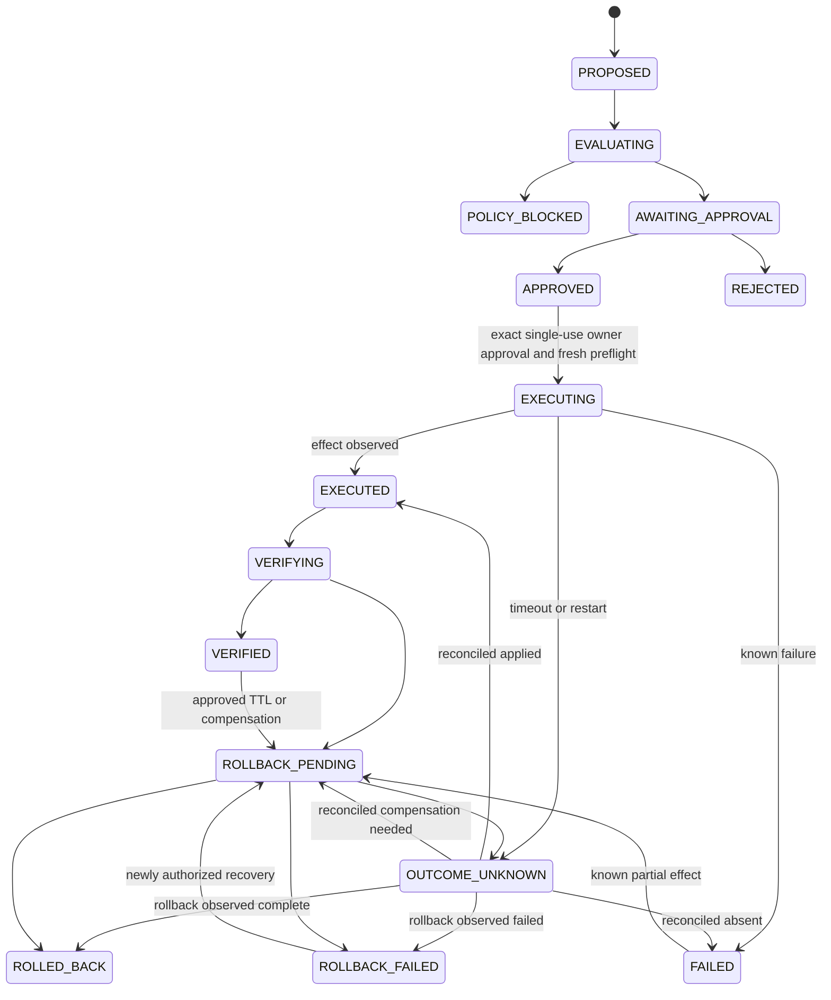

# Sentinel security model proposal

Status: proposed extension of [the current security model](../SECURITY.md), not implemented controls. Existing R01–R20, accepted ADRs and architecture guardrails remain in force. The owner selected a separate small Sentinel VPS reachable through a VPN and a first useful release of read-only monitoring plus Android notifications through an existing transport. Response execution, remote MCP and the custom mobile client require later accepted gates.

## Assets, actors and boundaries

Protect provider credentials, adapter/device credentials, incident history, private source findings, telemetry and personal data, action approvals, deployment identities, evidence integrity, notification content and availability of the protected application. The Sentinel itself is a sensitive application and must be auditable as an OpenTatu Audit target.

Actors are the owner, authenticated adapter instances, registered owner devices, authorized development agents, bounded internal investigation roles, the deterministic policy/execution service and notification/provider services. The single-owner model remains; application scope is still required to prevent one protected app's evidence or adapter from accessing another app.

Treat analyzed repositories, log entries, metric labels, routes, webhooks, scanner results, peer-agent messages, generated code, MCP tool outputs, external enrichment and model responses as untrusted. An adapter credential proves which adapter submitted data; it does not prove the application host is uncompromised or the reported event is true. A malicious source can send plausible lies and must not obtain action authority through high severity claims.

The selected dedicated VPS separates Sentinel control-plane credentials from Abastevo's production host. Connect through the VPN using narrowly scoped endpoints and credentials. A VPN connection does not replace application authentication. Factory discovery/build environments receive no production, incident-store or response-execution credentials. The notification service and model provider are external data recipients with explicit data minimization rules.

## Preserve existing controls

Reuse the current `Secret` wrapper, masked output, strict prompt rendering, untrusted-content fences, exact-commit snapshots, immutable event log and service-layer transactions. Keep the dashboard's Host/Origin protections, escaping, CSP and no-JavaScript design. Keep SQL out of interfaces and process execution out of agent tools.

The current dashboard only permits loopback and has no remote owner authentication. Existing documentation of TOTP, short sessions and VPN deployment does not establish an implemented login system. Implement and test authentication before enabling owner remote access or mobile APIs. Browser CSRF/session protections and API token authentication require different checks; do not broadly disable Origin middleware to accommodate a native client.

The existing process restriction has a documented hardened-git exception in snapshots (ADR-0020), in addition to isolated scanner containers. This exception is not authority for the Factory to execute arbitrary build scripts. New execution infrastructure needs an accepted design and explicit guardrail ownership. Existing scanner isolation flags are a starting point, not a complete Factory sandbox specification.

## Authentication and least privilege

Bind credentials to purpose and audience: telemetry ingestion, Factory development, Investigation MCP, Audit fixing MCP, owner device access and future response execution. Require explicit application/environment scope. Verify audience, issuer where applicable, expiry, revocation and capabilities at the service use case as well as at transport dispatch. Model-supplied application IDs cannot override the authenticated scope.

Adapter registration verifies owner control, capabilities and endpoint identity before activation. Choose and document authenticated transport and token/certificate lifecycle during the contract gate; do not invent a custom signing protocol. If event signatures are needed for buffered/untrusted hops, cover canonical versioned content, source identity, stream epoch, sequence and key ID and use an established library/format. TLS alone and per-event signatures solve different threats; neither establishes truth on a compromised source host.

Store only verifier material for opaque tokens where practical; keep private keys/tokens protected by local permissions and the selected secret storage mechanism. Rotate and revoke per adapter/device without replacing all credentials. Record registration, grants, rotations, revocations and rejected capability escalation without logging credentials. Test stale credentials after revocation and reconnect.

Owner pairing must occur through an already-authenticated path or a short-lived, single-use challenge confirmed on the trusted Sentinel instance. The custom mobile client later needs secure platform credential storage, device list/revocation, lock-screen privacy and reauthentication for sensitive approvals. Losing a device cannot grant indefinite incident access. Define an offline owner recovery procedure; recovery itself is auditable.

## Telemetry input and privacy

Authenticate before expensive parsing. Enforce request/batch/event size, nesting, field length, compressed expansion, event rate and per-application quotas. Reject unsupported schema versions. Preserve unknown extension data only inside bounded, namespaced fields with explicit privacy classification; do not silently accept arbitrary top-level security semantics.

Normalize route templates and allowlisted metadata. Avoid raw request bodies, authorization headers, cookies, password/token values, query strings and personal business records. Hash or pseudonymize subject/network identifiers with a scoped keyed mechanism when correlation needs them; unkeyed hashes of predictable emails/IPs are not anonymization. Treat pseudonymous identifiers as sensitive. Define whether rotation intentionally prevents long-term linkage.

Validate evidence paths, archive entries and filenames against the application and data root. Reject traversal, symlinks, device files, oversized files and active content; serve evidence as escaped text/downloads under restrictive headers. Bind evidence digests, origin, collection time, adapter version and access classification. A digest detects a mismatch; it does not make false source content trustworthy.

`observed_at` is untrusted source time. Server receipt, authorization, expiry, task and action timestamps come from `Clock`. Reject impossible timestamp encodings, record clock skew/uncertainty and handle late delivery without changing recorded history. Use scoped idempotency identities; detect the same identity reused with different content. A replay must not create a second incident, repeat an action or suppress a genuinely new stream epoch.

Apply minimization before persistence and before any provider/export boundary. Existing Audit consent to send skeptic/reporter context to a training model does not authorize sending Sentinel runtime telemetry, personal data or new roles. Add an explicit data-class/role/provider policy and keep denied fields out of prompts, traces, errors, notifications and support bundles.

## Retention, history and evidence expiry

The owner approved the direction of expiring raw telemetry and sensitive evidence while retaining minimized permanent incident history. Exact data classes, durations, minimum retained evidence, holds, backup expiry and deletion verification remain open. An accepted ADR/spec clarification must define this boundary before retention deletes any newly collected payload.

R04 and existing event-log triggers remain unchanged. Keep permanent incident decisions, owner approvals, policy versions, action outcomes and audit provenance append-only and free of unnecessary raw personal data. Expiration of temporary payloads is an explicit event referencing what expired; projections show that evidence bytes are unavailable. Conclusions cannot silently retain a level of confidence that requires evidence already removed. Decide whether retained minimized proof suffices or reclassify as historical/unverifiable with a reason.

Retain immutable references/digests only where they do not themselves violate the agreed privacy boundary. Exports, backups and notification-provider copies need their own documented retention behavior; deleting the live payload does not erase those copies. Apply the policy consistently rather than disabling R04 or weakening database triggers.

## Agent isolation and prompt injection

Enforce capabilities in typed deterministic tool handlers. The model chooses neither its own scopes nor new tools. Keep separate MCP profiles, registries, token audiences and minimal process environments for development, fixing and investigation. A Factory token cannot query live incidents or use an Investigation tool, and a security role cannot install an adapter.

Use strict structured inputs and outputs; fence telemetry and peer messages as untrusted evidence. Validate IDs, evidence references, app scope, enum values, bounded text and state transitions after parsing. A message from the coordinator or another agent is not a privileged system instruction. Tool results must not include secrets or unrelated applications. Fences reduce accidental instruction confusion but are not the authorization boundary.

Provide bounded read APIs such as query events by application/time/cursor, retrieve authorized incident evidence, retrieve health/deploy identity and correlate approved Audit findings. Do not expose generic HTTP fetch, arbitrary SQL, unrestricted filesystem, shell, Docker socket or database credentials. Constrain any future external enrichment to reviewed destinations, timeouts and data classes; prevent SSRF and redirect-based network expansion.

Use task-based scheduling with turn/message/tool/time/budget ceilings, delegation-depth/cycle checks, per-app concurrency and cancellation. Reserve shared budgets before dispatch; current per-audit usage checks do not supply a hard cap for concurrent teams. Persist sufficient summaries to resume after restart without replaying unlimited model calls. Record operational rationale, hypotheses and evidence summaries; do not request or persist private chain-of-thought.

## Adapter Factory supply chain

Discovery is read-only and authorized for an exact repository/revision. Reuse hardened snapshots rather than shell interpolation or executing repository-provided discovery commands. Repositories cannot redefine Factory policy through documentation, AGENTS files or generated manifests. The owner can inspect a proposed integration before code generation and a concrete diff/package before installation.

The Factory states should distinguish discovered, proposed, generation-approved, generated, validated, packaged, installation-approved, installed, activation-approved and active. Rejection/revocation/expiry are explicit. Approval binds repository/revision, workspace, template/contract version, permitted changes, requested capabilities and package digest; altered artifacts or capabilities invalidate earlier approvals.

Generation and tests run in a disposable isolated workspace with pinned toolchain/template provenance, bounded writable locations, no host mounts/secrets, no Docker socket and denied network by default. Any required dependency download uses an explicit, restricted supply-chain stage with declared network/destination policy. Never run untrusted hooks, package install scripts or build/test commands on the host merely because a repository requests them.

A package contains a declarative manifest, contract version, source provenance, build/test result references, permissions, compatibility and content digests. Validate archive paths and manifest claims before installation. Installation and activation remain separate from generation and from each other. A new version or permission increase requires review; rollback must restore known compatibility without restoring revoked credentials. The first release need not have automatic installation.

## Incidents and epistemic integrity

Separate suspicious signal, probable attack, confirmed compromise, false positive and operational issue. Deterministic rule hits are observations, not proof of compromise. Model unanimity, scanner severity, a repeated log string or a high event count is insufficient evidence alone. Record alternative explanations and missing evidence; use the skeptic/verifier responsibilities already present in Audit.

A confirmed compromise classification requires a documented evidence policy suitable for the relevant incident type and reviewer/owner gate selected before implementation. No initial read-only detector should label compromise automatically without that policy. Missing source coverage, stale data, expired evidence or unresolved deployment identity must remain visible in reports and owner answers.

Runtime containment does not prove root-cause remediation. Only the existing Audit reverification process closes an Audit finding (R06). Link the incident to its exact deployed revision and known Audit finding when established, without claiming that an outdated audit proves current exploitation.

## Response authorization and execution

The first useful release exposes no production action executor. Future releases accept only typed proposals referencing a registered, bounded, reversible playbook. The deterministic policy engine evaluates the proposal independently of model text. The owner approves a concrete reviewable action: application, environment, target scope, bounded parameters, evidence, expected impact, expiry, rollback and policy/version identity.

The candidate action lifecycle below includes evaluation, cancellation, uncertain effects and rollback failure. Define allowed transitions once in core and record every transition transactionally with an event. Keep notification acknowledgment separate from action approval.

An approval is single-use and bound to the exact proposal/action digest, owner/device identity, policy version, target, parameters and expiry. Execution rechecks approval validity, revocation, application scope, current policy, target identity and preconditions immediately before dispatch. Changes invalidate approval and require a new proposal. A push notification, conversational “yes” without a bound action, stale mobile screen or agent-to-agent message is not authorization.

Use an outbox/operation record with a stable idempotency key and a scoped external executor credential. External effects are not atomically committed with SQLite; after timeout/restart, reconcile using operation ID and observed target state before retrying. Record unknown outcome when it cannot be determined. Claiming exactly-once execution across the network would be misleading.

Bound targets, duration/TTL, affected subjects, parameter ranges, concurrency, cooldown and rollback. Recheck current state and deployment before applying. Do not block the owner's access or the notification path; protect known management/VPN endpoints through reviewed policy. Prefer expiration enforced by the target, not only an in-process timer, so a stopped Sentinel cannot leave indefinite containment behind. Verify effectiveness and collateral health independently, then roll back on the approved conditions. Report rollback failure and require owner intervention rather than claiming safety.

An owner override is recorded as R20 `OWNER_DECISION` with justification. It does not transform a model into a privileged executor or allow an unsigned request to bypass authentication. Changes to a fixed capability boundary require an explicit owner policy/configuration change and review under the accepted security design, not a chat-generated shell command. Reconcile any more permissive interpretation of R20 through a spec decision before response implementation.

## Notifications and mobile channels

Select an existing Android-capable notification transport for the read-only MVP. Verify its authentication, delivery semantics, outage behavior, privacy and retention in the notification phase; do not hardcode a guessed provider or send secrets in a provider payload. Use generic alert text, incident reference and severity with deeper content fetched through authenticated owner access where possible.

Store send attempt, provider acceptance, device delivery when supported, owner read and owner acknowledgment as distinct states. Retry transient failures with bounded backoff and deduplication; surface permanent failure and stale channel health. Critical alerts have deterministic fallback content during model outages. Select any fallback channel explicitly; do not silently send private incidents to a newly chosen service.

Custom KMP mobile later needs authenticated fetch, pagination/cursor sync, offline read
cache protection, device revocation, notification deep-link authorization and a separate
approval API. The initial mobile client does not queue offline approvals: it requires
fresh online state and authentication. Never embed provider, production or executor
credentials in the app or notification actions.

## Availability, host security and recovery

Cap memory, event bytes/cardinality, database/artifact growth, in-memory queues and task concurrency. Reserve ingestion/detection/alert capacity from Audit/scanner/model workloads. Detect disconnected sources, stale processing cursors, failed notification transport and unavailable providers independently. Event overload must emit a visible data-loss/coverage warning, not an empty reassuring dashboard.

At low disk space, apply only the accepted retention policy and explicit admission/backpressure rules. Preserve critical state/approval/execution history and report degraded monitoring. Do not acknowledge durable receipt when storage failed. If policy/state cannot be read or audited, block new defensive actions and reconcile any in-flight action; never trade audit integrity for a silent privileged side effect.

Run the dedicated service as a restricted user, harden its service unit, patch the host and expose only reviewed VPN endpoints. Production adapter credentials cannot administer the Sentinel host. Avoid root and Docker socket access; any future privileged helper must expose a minimal typed allowlist and require its own approved threat model. A root compromise of the Sentinel host is outside the protection supplied by SQLite triggers or `Secret`; use least privilege, recovery and external backups to limit impact.

Encrypt backups and protect local data through the selected disk/filesystem and key-management policy. SQLite is not implicitly encrypted by its use here. Produce consistent backups of database, artifact manifest and required configuration; keep secrets/keys separate under a recoverable owner policy. Test restore with synthetic data, schema versions, token revocation, lease expiry, notification replay and unknown action outcomes before deployment.

## Security acceptance evidence

Each implementing phase must supply source tests plus an isolated synthetic integration demonstration. Required cases include forged adapter identity, cross-app access, replay/conflicting duplicate, excessive metadata, source clock skew, lost connection, malformed event, prompt injection in logs/peer messages, Factory script/path escape, profile-token confusion, stale/revoked approval, changed action parameters, simultaneous approvals, restart after external effect, rollback failure, missing evidence, expired evidence, model outage, failed push, full disk and restore/replay.

Reuse `FixedClock`, `Services::in_memory`, `FakeClient`, scanner `FakeSuite` and throwaway snapshot helpers. Do not execute invasive tests against production or commit real telemetry, credentials or private incident artifacts. Keep the mandatory `cargo xtask check` guardrails intact and add enforcement for new capability boundaries when implemented.

## Candidate incident and approval contracts

These are concrete field-level design proposals for SREQ-041–045 and SREQ-055–061, not accepted serialized production contracts. IDs shown below are illustrative; their canonical formats must be defined once in core at the contract gate. Required means required by the proposed contract, not already implemented. Publish machine-validated JSON Schemas and compatibility fixtures when the gate is accepted. Versioned records reject unknown privileged fields; optional extensibility cannot change scopes or state semantics.

### Incident record

Required fields:

- `schema_version`: semantic contract version string; reject unsupported major versions.
- `incident_id`: server-assigned typed ID.
- `application_id`: registered `Slug`, fixed for the incident and authorized from the source binding.
- `revision`: monotonically increasing unsigned integer for optimistic concurrency.
- `lifecycle`: `OPEN | INVESTIGATING | CONTAINED | RESOLVED`.
- `classification`: `UNKNOWN | SUSPICIOUS_SIGNAL | PROBABLE_ATTACK | CONFIRMED_COMPROMISE | FALSE_POSITIVE | OPERATIONAL_ISSUE`.
- `priority`: existing core severity value used as triage priority under a separately approved incident-priority policy; do not apply the Audit vulnerability matrix to runtime confidence automatically.
- `confidence`: `LOW | MEDIUM | HIGH`; this is distinct from priority and lifecycle.
- `title` and `summary`: bounded owner-facing strings, pt-BR in the running product, with no secrets or executable markup.
- `opened_at`, `updated_at`, `last_signal_received_at`: server `Timestamp` from `Clock`.
- `correlation`: typed object containing rule identity/version, scoped grouping key, detection window and deduplication-policy version.
- `signal_references`: bounded list of typed internal signal IDs; no arbitrary URLs or filesystem paths.
- `evidence_references`: bounded objects containing `evidence_id`, `application_id`, `source_kind`, `source_id`, `content_digest`, `collected_at`, `availability` (`AVAILABLE | EXPIRED | MISSING | QUARANTINED`) and privacy class. Raw evidence bytes are separate.
- `coverage`: source freshness/health, applicable rules and bounded limitation codes; unknown coverage is explicit.
- `created_by` and `last_transition_event_id`: authenticated actor and append-only event reference.

Optional fields:

- `first_observed_at`, `last_observed_at` and `source_clock_uncertainty`: source-reported observations with validation metadata, never approval clocks.
- `audit_links`: bounded objects with finding/audit IDs, audited commit, deployed commit when known, route/component mapping and `relationship` (`EXACT_REVISION | QUALIFIED_MATCH | STALE | UNKNOWN`).
- `assigned_team_id`, `active_task_ids`: authorized references, not capability grants.
- `conclusion`: structured supporting evidence IDs, alternative explanations, missing evidence, policy version, reviewer/owner actor and determination time.
- `resolution`: outcome code, supporting verification references, owner/system actor, `resolved_at` from `Clock` and follow-up tasks. Required when transitioning to `RESOLVED`.

Legal lifecycle transitions are `OPEN -> INVESTIGATING | RESOLVED`, `INVESTIGATING -> CONTAINED | RESOLVED`, `CONTAINED -> INVESTIGATING | RESOLVED`, and `RESOLVED -> INVESTIGATING` only when new evidence meets the documented reopen/correlation policy. Direct `OPEN -> RESOLVED` is limited to explicit documented triage such as a false positive or operational issue, not silent suppression. Each transition records its reason and evidence references in the same transaction as the projection update. Classification changes are separate appended determinations with revision checks; `CONFIRMED_COMPROMISE` requires the approved evidence/reviewer policy. `CONTAINED` requires observed containment evidence and does not imply a fixed Audit finding. Runtime resolution never invokes an R06 finding close operation.

### Action proposal record

Required fields:

- `schema_version`, `proposal_id`, `incident_id`, `application_id`, `revision` and server `created_at`.
- `proposed_by`: authenticated owner/agent identity and originating task/tool invocation reference.
- `playbook_id` and `playbook_version`: reviewed typed operation definition; no command string.
- `environment`: `LAB | PRODUCTION`, with the first real integration permitting observation only and simulations targeting `LAB`.
- `target`: typed object with configured adapter/executor ID, protected resource ID and bounded scope. The target cannot be an arbitrary host/path/URL supplied by a model.
- `parameters`: playbook-specific schema-validated values; unknown fields and excessive range/scope are rejected.
- `evidence_references`: authorized incident evidence IDs and availability requirements.
- `policy_version`, `preconditions` and `expected_target_revision`: deterministic policy identity, typed conditions and current configuration/deploy identity.
- `impact`: bounded expected impact, false-positive risk and protected owner-access checks.
- `expires_at`: server-computed proposal expiry.
- `effect_ttl`: target-enforced maximum effect duration under the approved playbook.
- `rollback`: typed rollback playbook/version, validated parameters, expected conditions and expiry behavior. No arbitrary compensation script.
- `simulation_result`: result/reference plus `NOT_RUN | PASSED | FAILED | UNSUPPORTED`; production approval policy decides which is admissible.
- `action_digest`: cryptographic digest of canonical serialized action content including app, incident, environment, target, playbook/version, parameters, policy, preconditions, effect TTL, rollback and expiry.

Proposal content is immutable after generation of `action_digest`. Updating evidence, parameters, scope or an approval-relevant policy creates a replacement proposal/digest linked to the old one. Define canonicalization and digest algorithms using standard supported libraries before interoperability tests; don't hash a serializer's unstable object order.

### Approval record

Separate an immutable `ActionDecision` from its optional execution grant. The decision
requires `schema_version`, `decision_id`, `proposal_id`, `action_digest`, `application_id`,
authenticated `owner_actor`, `device_id`, `session_id`, `authentication_strength`,
`policy_version`, server `decided_at`, `decision` (`APPROVE | REJECT | REQUEST_INFORMATION`)
and `decision_event_id`. Only `APPROVE` may create an `Approval` grant, which additionally
requires `approval_id`, `decision_id`, server `approved_at`/`expires_at`, one-time `nonce`
and `state` (`ACTIVE | CONSUMED | REVOKED | EXPIRED`). Rejection and information requests
have a null grant reference and can never be consumed for execution. A bounded
`justification` is required by owner-override policy and available otherwise. Only
authenticated owner context supplies owner/device/session fields; clients cannot
self-assert authentication strength.

An approval stores its exact permitted target/parameter digest and granted capability scope; it is neither a bearer action token copied into a notification nor a reusable permission grant. Claiming it for execution atomically checks state/expiry/revocation and transitions `ACTIVE -> CONSUMED` in the same transaction that creates the execution intent and immutable authorization event. A consumed approval never becomes active again. Provider timeout or restart does not create a second authorization. New action attempts beyond reconciliation need a new proposal/approval. Reject stale `expected_revision` and return current state without executing.

### Execution and immutable event accounting

Execution requires `execution_id`, proposal/approval/digest references, application, playbook/version, target, stable operation/idempotency ID, server lifecycle timestamps, attempt counter, preflight result, effect status (`NONE | APPLIED | UNKNOWN | REVERTED`), effect evidence references, verification result, rollback execution reference and failure code when applicable. `OUTCOME_UNKNOWN` must include `unknown_operation_phase` (`FORWARD | VERIFICATION | ROLLBACK`) and record what cannot yet be established. Tool errors and external responses are bounded and masked.

Use one immutable authorization event for an owner decision, one transition event per successful state transition, and one attributable tool-call record per invocation under Q-007; link them causally without double-recording a mutating tool's invocation as an extra equivalent domain event. Denied calls still need the accepted MCP audit policy's denial accounting. A retried transport request uses its invocation idempotency key to return the prior result; a new invocation is a distinct audited call even when it reads the same domain operation. State, approval consumption and outbox intent commit atomically. External dispatch/result observations append further events because no SQLite transaction can include a remote side effect.

### Complete candidate action transition relation

The following lists all permitted successors. Unlisted transitions are forbidden. Expiry and approval revocation are checked using server `Clock` before claim, and policy/preconditions are checked immediately before dispatch.

- `PROPOSED -> EVALUATING | CANCELLED | EXPIRED`.
- `EVALUATING -> POLICY_BLOCKED | AWAITING_APPROVAL | CANCELLED | EXPIRED`.
- `AWAITING_APPROVAL -> APPROVED | REJECTED | CANCELLED | EXPIRED`.
- `APPROVED -> EXECUTING | REVOKED | CANCELLED | EXPIRED`. An invalidated preflight uses `REVOKED` with a reason and requires a replacement proposal for any changed action.
- `EXECUTING -> EXECUTED | FAILED | OUTCOME_UNKNOWN`. `FAILED` here requires proof of no effect or a documented known partial effect. Cancellation after dispatch is a request, not proof that no effect occurred.
- `EXECUTED -> VERIFYING | ROLLBACK_PENDING`.
- `VERIFYING -> VERIFIED | FAILED | OUTCOME_UNKNOWN | ROLLBACK_PENDING`. Verification failure records whether the external effect remains applied.
- `VERIFIED -> ROLLBACK_PENDING` when the approved expiry/compensation plan requires removal of the temporary effect. Verification does not make the effect indefinite.
- `FAILED -> ROLLBACK_PENDING` only for an observed applied/partial effect with an approved applicable compensation; otherwise `FAILED` is terminal for that operation.
- `OUTCOME_UNKNOWN -> EXECUTED | FAILED | ROLLBACK_PENDING | ROLLED_BACK | ROLLBACK_FAILED` only after deterministic reconciliation observes the effect and records evidence. Forward/verification uncertainty reconciles to `EXECUTED`, `FAILED` or `ROLLBACK_PENDING`; rollback uncertainty reconciles to `ROLLED_BACK`, `ROLLBACK_FAILED` or `ROLLBACK_PENDING` according to the observed compensation state. Never retry the forward operation merely to find out what happened.
- `ROLLBACK_PENDING -> ROLLED_BACK | ROLLBACK_FAILED | OUTCOME_UNKNOWN`. Uncertain rollback outcomes retain the forward and compensation operation identities so reconciliation can establish which effect exists.
- `ROLLBACK_FAILED -> ROLLBACK_PENDING` only with a newly authorized, bounded recovery execution linked to the original record; do not reuse the consumed forward approval.
- `POLICY_BLOCKED`, `REJECTED`, `CANCELLED`, `EXPIRED`, `REVOKED` and `ROLLED_BACK` are terminal. Reconsideration creates a new linked proposal. `VERIFIED` and `FAILED` are terminal except for the explicitly specified rollback conditions.

Every transition must also pass application scope, optimistic revision, expected source state, evidence/precondition and actor-capability checks. A cancellation or emergency stop blocks undispatched work and initiates reconciliation/approved rollback of dispatched work. It never erases an execution record.

The diagram highlights execution/reconciliation. The complete relation above additionally governs pre-dispatch `CANCELLED`, `EXPIRED` and `REVOKED` outcomes and verification-to-failure/unknown transitions.

## Threat register and residual risk

This register maps concrete trust failures to implementation checks and owner gates under SREQ-095–098. It is a planning acceptance register, not a statement that controls have passed.

- **TH-01 — Forged/cross-app telemetry:** actor is an attacker or compromised adapter; boundary is ingestion. Mitigate with authenticated source/app binding, scoped credentials, schema limits and integrity checks. Test forged app IDs, conflicting duplicates and revoked keys. Residual risk: an authorized compromised source can report false observations. Owner gate: registration/integrity contract and allowed sources.
- **TH-02 — Prompt or tool-output injection:** actor controls logs/repository/tool content; boundary is model context to tools. Mitigate with fenced typed inputs and deterministic authorization; test malicious peer/log/repository fixtures. Residual risk: analysis quality may degrade even when privilege escalation is blocked. Owner gate: scoped investigation capabilities and evidence standards.
- **TH-03 — Factory workspace escape/supply-chain code:** actor controls repository/build dependency; boundary is development sandbox to host. Mitigate with disposable isolation, pinned provenance, no host secrets/socket and restricted downloads. Test hooks, symlinks, traversal, network escape and scripts. Residual risk: sandbox/kernel/toolchain vulnerabilities remain. Owner gate: execution/runtime ADR and reviewed installation artifact.
- **TH-04 — MCP capability confusion:** actor is a compromised development/investigation agent; boundary is distinct MCP profiles and service scopes. Mitigate with separate registries/audiences/environments and scoped service authorization. Test wrong-audience and cross-profile tokens plus parameter-based scope escalation. Residual risk: same-owner host compromise can defeat process environment separation. Owner gate: remote transport and privilege boundaries.
- **TH-05 — Data exfiltration/provider disclosure:** actor is malicious source/agent/provider; boundary is persistence/export/model/notification output. Mitigate with minimization, egress/data-class policy, masking and minimized notification payload. Test secret canaries in all outputs and policy-denied provider calls. Residual risk: approved external recipients can retain permitted metadata under their terms. Owner gate: runtime-data/provider/notification disclosure policy.
- **TH-06 — Message/approval replay or stale action:** actor controls a device/session/request replay; boundary is owner intent to execution. Mitigate with fresh authentication, digest binding, nonce, server expiry, atomic single-use consumption and preflight. Test duplicate approval, altered scope/parameters, offline-stale approval and revocation race. Residual risk: a fully compromised unlocked owner device may act as the owner until revoked. Owner gate: reauthentication/recovery and response allowlist.
- **TH-07 — Response creates denial of service:** actor is mistaken/compromised agent or malicious stimulus; boundary is recommendation to production effect. Mitigate with read-only MVP, reviewed bounded playbooks, target TTL, protected admin paths, health guards and rollback. Test false-positive block, rollback failure and lost Sentinel connectivity. Residual risk: an approved bounded action can still degrade availability. Owner gate: per-playbook blast radius, expiry and independent recovery.
- **TH-08 — Unknown external effect after crash/timeout:** actor is a network/system failure; boundary is SQLite intent to external effect. Mitigate with operation identity, effect reconciliation and unknown state. Test restart at every dispatch/result commit boundary. Residual risk: a target without idempotency/readback may prevent reliable reconciliation and is ineligible for automatic execution. Owner gate: executor target capability and operator recovery plan.
- **TH-09 — Event/cost/resource storm:** actor is attacker, buggy adapter or agent loop; boundary is bounded resource admission. Mitigate with quotas, durable cursors, budget reservations, turn caps, priority capacity and explicit loss accounting. Test saturation/invalid batches/delegation cycles/provider fallback loops. Residual risk: sufficiently large traffic can exceed a small VPS; monitoring becomes visibly degraded. Owner gate: hardware/workload/caps and alert latency targets.
- **TH-10 — History/evidence tampering or unsafe expiry:** actor is buggy component, local attacker or retention job; boundary is evidence bytes versus permanent decision history. Mitigate with append-only transitions, digests, access policy, expiry events and consistent backups. Test unauthorized mutation, missing evidence, expiry and restore. Residual risk: local root can change database/files and evidence expiry reduces later verifiability. Owner gate: accepted R04 retention interpretation and data durations.
- **TH-11 — Silent Sentinel/source/notification outage:** actor is a host/network/storage failure; boundary is monitoring health to owner awareness. Mitigate with source freshness, processing/outbox health and an external watchdog in a separate failure domain. Test the Sentinel VPS offline from outside it and notification transport failure. Residual risk: shared network/provider outages may affect primary and fallback channels. Owner gate: independent watchdog/fallback service and disclosure choices.
- **TH-12 — Host/device/key compromise:** actor gains restricted or root access; boundary is runtime/OS/credential storage. Mitigate with separate VPS, restricted service user, VPN/auth, per-source/device revocation, encrypted backups, patching and recovery drills. Test a synthetic lost-device/revoked-source recovery and backup restore. Residual risk: host root can read process memory and defeat in-process controls; no false claim of protection after full host compromise. Owner gate: host hardening, key custody, backup and incident recovery policy.
